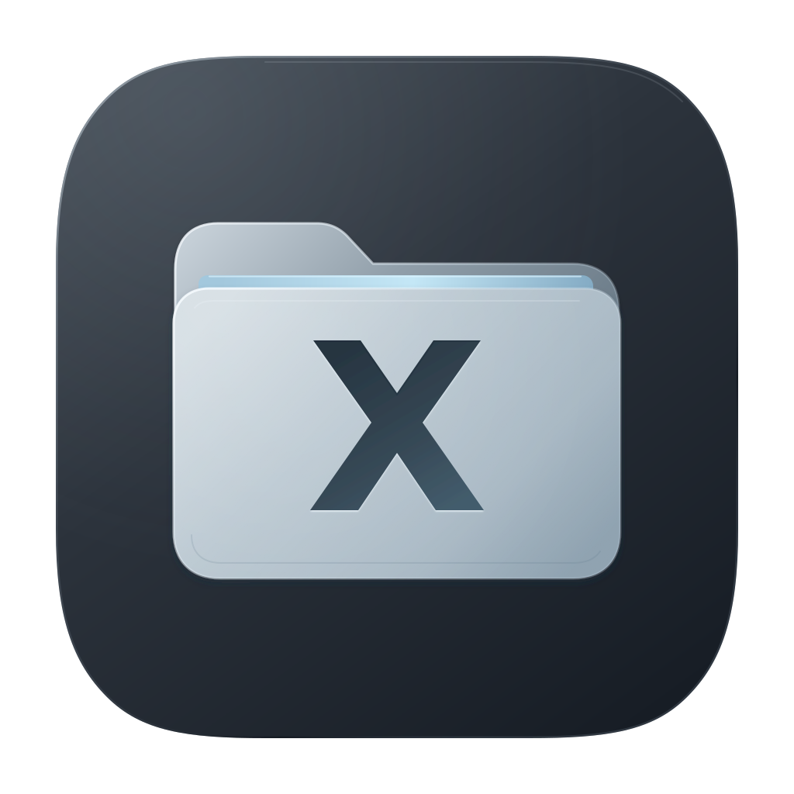

  

# XFile

一个专注于批量整理文件与目录的桌面工具。

归并分散的目录、提取深层文件、导出目录结构、批量修改名称。适用于 macOS 和 Windows，文件处理在本地完成，无需部署服务。

[下载安装](#下载安装) · [功能特性](#功能特性)

## 下载安装

前往 [GitHub Releases](https://github.com/xiaoke4869/xfile/releases/latest) 下载最新版本。

- **macOS**：下载 `.dmg` 安装包，打开后将 XFile 拖入“应用程序”。支持 Intel 和 Apple Silicon，要求 macOS 12 或更新版本。
- **Windows**：下载 `windows-x64-setup.exe` 安装包，运行并按提示安装。

## 功能特性

- **分屏浏览**：并排查看多个目录，支持在分屏之间拖拽移动文件和文件夹。
- **合并文件夹**：将选中的文件和文件夹移动到新文件夹，也可通过拖拽文件创建文件夹。
- **归并目录**：按规则将不同位置的文件夹归并到一起，保留内部结构。
- **提取文件**：将多层文件夹中的文件集中移动到指定目录。
- **文件结构导出**：将目录内容导出为文件清单或目录树。
- **批量重命名**：批量替换名称、添加前后缀或连续编号，支持预览修改结果。
